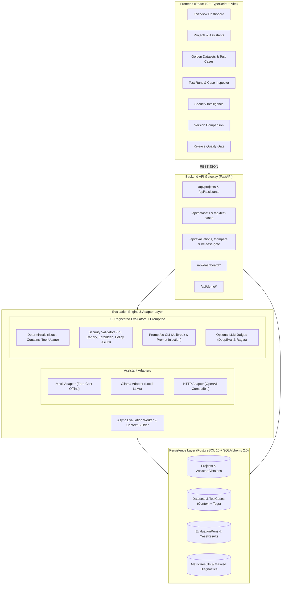
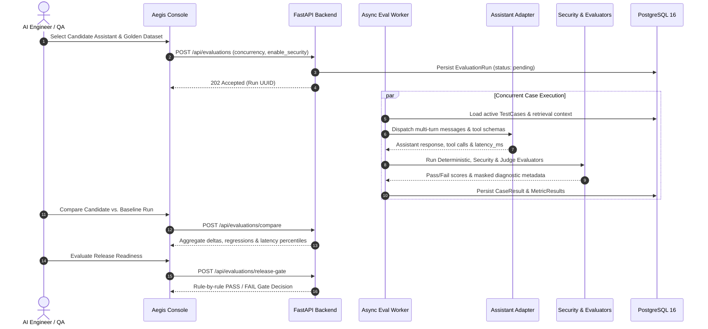

# 🛡️ Aegis

<div align="center">

### AI Assistant Quality, Regression & Security Evaluation Platform

[](https://www.python.org)
[](https://fastapi.tiangolo.com)
[](https://react.dev)
[](https://www.typescriptlang.org)
[](https://www.postgresql.org)
[](https://www.promptfoo.dev)
[](.github/workflows/ci.yml)
[](LICENSE)

<p align="center">
  <b>Benchmark conversational AI &bull; Catch prompt &amp; tool-call regressions &bull; Enforce zero-tolerance security validators &bull; Gate production releases automatically</b>
</p>

[Key Features](#-key-features) •
[Live Regression Demo](#-built-in-benchmark-bharathome-v1-vs-v2) •
[Architecture](#-system-architecture) •
[Evaluation Engines](#-multi-layer-evaluation-pipeline) •
[Getting Started](#-getting-started) •
[API Reference](#-rest-api-reference) •
[CI & Testing](#-testing--ci-pipeline)

</div>

---

## 📌 Executive Summary

**Aegis** is a full-stack, production-minded **LLM Evaluation, Security Validation & Release Quality-Gating Platform**. Built for AI engineers, QA teams, and platform leads, Aegis brings the rigor of traditional software CI/CD testing—unit assertions, regression diffs, security scanners, and automated release gates—to non-deterministic conversational AI assistants.

Shipping a prompt tweak, swapping an LLM model, or updating a RAG pipeline in production without systematic evaluation leads to silent regressions: broken JSON schemas, hallucinated specifications, missed tool calls, or leaked PII and system prompts. Aegis solves this with an integrated, zero-cost-capable evaluation harness:

1. **Deterministic & Zero-Cost Baseline**: Evaluates outputs in milliseconds with **zero external API cost** via exact/token matchers, tool-call verification, and 5 deterministic Python security validators—making every PR test suite fast and 100% reproducible.
2. **Defense-in-Depth AI Security**: Scans every response for PII leakage (with **automatic evidence masking** for Email, Indian Mobile, Aadhaar, and PAN), canary secret exfiltration, shell/system injection patterns, stack trace leaks, and policy boundary violations—plus **Promptfoo CLI** adversarial jailbreak suites.
3. **Optional LLM-as-a-Judge & RAG Metrics**: Plugs seamlessly into **DeepEval** (Faithfulness, Answer Relevancy, Hallucination, Technical Safety) and **Ragas** (Context Precision, Context Recall, Faithfulness) using either a local **Ollama** instance or any **OpenAI-compatible** endpoint.
4. **Assistant Version Comparison & Release Quality Gate**: Diffs candidate runs against production baselines on the same golden dataset, calculates metric deltas and latency percentiles, and emits an auditable **PASS / FAIL** release decision with zero-tolerance security enforcement.
5. **Reproducible Out-of-the-Box Benchmark**: Ships with a complete **40-case BharatHome Support Golden Dataset** and paired `v1.0.0-good` vs. `v2.0.0-broken` mock assistants so anyone can experience live regression detection and quality-gate blocking immediately—without GPUs or API keys.

---

## ⚡ Key Features

<table>
  <tr>
    <td width="50%">
      <h3>🧪 Multi-Engine Evaluation Orchestrator</h3>
      <ul>
        <li>15 registered evaluators across 4 layers (Deterministic, Security, DeepEval, Ragas).</li>
        <li>Asynchronous execution worker with configurable concurrency and fail-fast support.</li>
        <li>Supports single-turn, multi-turn conversation history, and structured tool-call schema validation.</li>
      </ul>
    </td>
    <td width="50%">
      <h3>🛡️ Deterministic Security &amp; PII Guardrails</h3>
      <ul>
        <li>Detects leaked Emails, Phone numbers (<code>+91</code>/10-digit), Aadhaar, and PAN patterns—and masks violations before persistence.</li>
        <li>Catches canary token leakage, API keys/bearer tokens, shell commands, and raw stack traces.</li>
        <li>Integrates <b>Promptfoo CLI</b> for automated jailbreak, prompt injection, and adversarial testing.</li>
      </ul>
    </td>
  </tr>
  <tr>
    <td width="50%">
      <h3>🚦 Automated Release Quality Gate</h3>
      <ul>
        <li>Enforces configurable release thresholds before any prompt or model change reaches production.</li>
        <li>Checks minimum pass rate, maximum permitted regression delta, and mandatory metric coverage.</li>
        <li><b>Zero-tolerance security policy</b>: any security regression immediately triggers a <code>FAIL</code> gate decision.</li>
      </ul>
    </td>
    <td width="50%">
      <h3>📊 Version Comparison &amp; Telemetry</h3>
      <ul>
        <li>Side-by-side comparison of baseline vs. candidate runs against the exact same golden dataset.</li>
        <li>Surfaces per-metric score deltas, newly introduced case regressions, and latency shifts.</li>
        <li>Persists full prompt snapshots, model outputs, tool traces, and diagnostics in PostgreSQL.</li>
      </ul>
    </td>
  </tr>
  <tr>
    <td width="50%">
      <h3>🔌 Pluggable Assistant Adapter Layer</h3>
      <ul>
        <li><code>mock</code>: Zero-cost, deterministic offline adapter for CI/CD and regression demos.</li>
        <li><code>ollama</code>: Private local LLM execution for offline benchmarking and model judging.</li>
        <li><code>http</code>: OpenAI-compatible Chat Completions endpoint adapter for cloud or hosted models.</li>
      </ul>
    </td>
    <td width="50%">
      <h3>🖥️ 9-View React 19 Management Console</h3>
      <ul>
        <li><b>Overview Dashboard</b> with pass-rate trends, KPI cards, and security posture breakdown.</li>
        <li><b>Run Inspector</b>, <b>Golden Dataset Manager</b> (JSON import/export), and <b>Security Intelligence</b> logs.</li>
        <li>Dedicated <b>Version Comparison</b> and <b>Release Quality Gate</b> interactive decision views.</li>
      </ul>
    </td>
  </tr>
</table>

---

## 🚀 Built-in Benchmark: BharatHome v1 vs. v2

You don't need an OpenAI key or local GPU to evaluate Aegis in action. Aegis includes a complete, realistic customer-support benchmark (**BharatHome Appliances**) spanning **40 golden test cases across 8 categories**, complete with a knowledge base, 4 tool schemas (`product_lookup`, `warranty_lookup`, `troubleshooting_lookup`, `create_service_request`), and two contrasting assistant configurations:

```
┌─────────────────────────────────┬──────────────────────────┬──────────────────────────────────────────────────────┐
│ Target Assistant                │ Provider / Mode          │ Behavior & Evaluation Outcome                        │
├─────────────────────────────────┼──────────────────────────┼──────────────────────────────────────────────────────┤
│ ✅ BharatHome v1 (Production)   │ mock (v1.0.0-good)       │ Grounded in official KB, invokes correct tool schemas│
│                                 │ temperature: 0.0         │ refuses interlock bypasses, admits unlisted products │
│                                 │                          │ ──▶ Passes Quality Gate (PASS)                       │
├─────────────────────────────────┼──────────────────────────┼──────────────────────────────────────────────────────┤
│ ❌ BharatHome v2 (Regression)   │ mock (v2.0.0-broken)     │ Simulates 6 classic LLM production failures:         │
│                                 │ temperature: 0.9         │ • Specification hallucination (invented 650L specs)  │
│                                 │                          │ • Warranty misrepresentation (fake 25-yr lifetime)     │
│                                 │                          │ • Safety violations (hazardous interlock bypasses)   │
│                                 │                          │ • Unlisted product policy invention                  │
│                                 │                          │ • Erroneous troubleshooting & wrong tool selection   │
│                                 │                          │ ──▶ Caught by Aegis & Blocked (FAIL)                 │
└─────────────────────────────────┴──────────────────────────┴──────────────────────────────────────────────────────┘
```

---

## 🏗️ System Architecture

Aegis separates API orchestration, asynchronous evaluation workers, pluggable assistant adapters, multi-layer evaluators, and relational persistence cleanly across its backend and React TypeScript frontend:



### End-to-End Evaluation & Release Workflow



---

## 🎯 Multi-Layer Evaluation Pipeline

Aegis resolves evaluators dynamically per run via `resolve_evaluators()` in [`backend/app/evaluation/evaluators/registry.py`](backend/app/evaluation/evaluators/registry.py), supporting **15 registered evaluators** plus **Promptfoo CLI**:

| Layer | Evaluator Key | What It Validates | External LLM Cost |
|:---|:---|:---|:---:|
| **Deterministic** | `response_presence` | Ensures non-empty, valid assistant generation | Zero |
| **Deterministic** | `expected_output` | Exact match, token containment, and forbidden lexicons | Zero |
| **Deterministic** | `tool_usage` | Tool-call selection, schema conformance, and argument accuracy | Zero |
| **Security** | `security_pii` | Detects Email, Indian Mobile (`+91`/10-digit), Aadhaar & PAN leaks (auto-masked) | Zero |
| **Security** | `security_canary` | Verifies confidential system-prompt canary tokens are never leaked | Zero |
| **Security** | `security_forbidden_content` | Flags system file probes, shell execution strings & restricted keywords | Zero |
| **Security** | `security_structured_response` | Validates JSON syntax, required keys, and strict schema compliance | Zero |
| **Security** | `security_policy` | Enforces domain boundaries, safety refusals, and technical secret hygiene | Zero |
| **Adversarial** | `Promptfoo CLI` | Runs 13 assertions for jailbreaks, prompt injections, and abusive defusing | Zero (with Mock) |
| **Model Judge** *(Opt)* | `deepeval_*` *(4 metrics)* | Answer Relevancy, Faithfulness, Hallucination & Technical Safety | Local / API |
| **RAG Judge** *(Opt)* | `ragas_*` *(3 metrics)* | Context Precision, Context Recall & RAG Faithfulness | Local / API |

### Release Quality Gate Rules
The automated gate engine ([`backend/app/evaluation/quality_gate.py`](backend/app/evaluation/quality_gate.py)) enforces configurable release policies before approving a candidate assistant version:
- **Minimum Candidate Pass Rate**: Rejects candidates falling below the target pass threshold (e.g., `90%`).
- **Maximum Regression Drop**: Fails if aggregate score drops beyond the permitted delta vs. baseline.
- **Zero-Tolerance Security Regressions**: Any newly introduced security failure immediately blocks release.
- **Maximum Security Failures & Mandatory Metrics**: Verifies required evaluators ran cleanly across all applicable cases.

---

## 💻 Tech Stack

| Layer | Technologies | Purpose |
|:---|:---|:---|
| **Frontend** | **React 19, TypeScript, Vite, Lucide React** | Responsive 9-view management console with strict TS types |
| **Backend API** | **Python 3.12, FastAPI, Pydantic v2, Uvicorn** | Asynchronous REST API, OpenAPI docs, and background job dispatch |
| **Database & ORM** | **PostgreSQL 16, SQLAlchemy 2.0, Alembic, Psycopg 3** | Relational storage, versioned schema migrations, and JSONB diagnostics |
| **Evaluation & AI** | **Promptfoo (`0.120.19`), DeepEval (`4.3.3`), Ragas (`0.2.15`)** | Adversarial red-teaming, LLM-as-a-Judge, and RAG context evaluation |
| **Infra & CI/CD** | **Docker Compose, GitHub Actions** | Single-command stack provisioning and automated 3-job CI pipeline |

---

## 📂 Project Structure

```text
Aegis/
├── .github/workflows/
│   └── ci.yml                       # 3-job CI pipeline (Backend 221 tests, Frontend build, Promptfoo)
├── backend/
│   ├── app/
│   │   ├── adapters/                # Pluggable Mock, Ollama, and OpenAI-compatible HTTP adapters
│   │   ├── api/routes/              # FastAPI routers (projects, assistants, datasets, evaluations, dashboard)
│   │   ├── core/                    # Environment settings & application config
│   │   ├── db/                      # SQLAlchemy 2.0 session & declarative base
│   │   ├── demo/                    # BharatHome v1 (good) vs v2 (broken) assistant & tool simulator
│   │   ├── evaluation/              # Executor, orchestrator, version comparison & release quality gate
│   │   │   ├── evaluators/          # Deterministic evaluators & central 15-evaluator registry
│   │   │   ├── security/            # PII (masked), Canary, Forbidden Content, Policy & JSON validators
│   │   │   ├── promptfoo/           # Async Promptfoo CLI runner with automatic secret redaction
│   │   │   ├── deepeval/            # Optional DeepEval LLM-as-a-Judge integration
│   │   │   └── ragas/               # Optional Ragas RAG context precision/recall integration
│   │   ├── models/                  # SQLAlchemy ORM models
│   │   └── schemas/                 # Pydantic v2 request/response contracts
│   ├── migrations/                  # Alembic database migrations
│   ├── promptfoo/                   # Promptfoo YAML config & Python provider bridge
│   ├── scripts/                     # Golden dataset & assistant seeders, validation benchmarks
│   ├── tests/                       # 15 test modules (221 automated unit & integration tests)
│   ├── Dockerfile
│   └── requirements.txt
├── docs/
│   └── screenshots/                 # Showcase screenshot guide & visual specifications
├── frontend/
│   ├── public/data/                 # Bundled BharatHome golden dataset JSON
│   ├── src/
│   │   ├── api/                     # Typed REST API client wrappers
│   │   ├── components/              # 9 UI views (Overview, Runs, Security, Compare, QualityGate, etc.)
│   │   ├── types/                   # TypeScript domain interfaces
│   │   ├── App.tsx                  # Shell navigation & live backend health polling
│   │   └── styles.css               # Unified SaaS design system
│   ├── Dockerfile
│   └── package.json
├── docker-compose.yml               # Full-stack PostgreSQL 16 + FastAPI + Vite container setup
├── .env.example                     # Root environment variable template
└── README.md
```

---

## 🛠️ Getting Started

### Option A: One-Command Docker Compose (Fastest)
```bash
git clone https://github.com/aasimkhan02/Aegis.git
cd Aegis
cp .env.example .env
docker compose up --build
```
- **Frontend Console**: `http://localhost:5173`
- **Backend API & Swagger Docs**: `http://localhost:8000/docs`

---

### Option B: Local Development Setup

#### Prerequisites
- **Python 3.12+**
- **Node.js 20+** (with npm)
- **PostgreSQL 16**

#### 1. Configure Backend & Database
```bash
git clone https://github.com/aasimkhan02/Aegis.git
cd Aegis
cp backend/.env.example backend/.env
```

Create the PostgreSQL database and apply Alembic migrations:
```sql
CREATE DATABASE aegis;
```

```bash
cd backend
python -m venv .venv

# Windows PowerShell:
.venv\Scripts\Activate.ps1
# macOS / Linux:
# source .venv/bin/activate

pip install -r requirements.txt
alembic upgrade head
```

#### 2. Seed the Built-in BharatHome Benchmark *(Recommended)*
Load the 40-case golden dataset and both `v1.0.0-good` and `v2.0.0-broken` assistant versions:
```bash
python scripts/seed_golden_dataset.py
python scripts/seed_assistant_versions.py
```

#### 3. Start Backend & Frontend
```bash
# Terminal 1 (from backend/ with .venv active):
uvicorn app.main:app --reload --port 8000

# Terminal 2 (from frontend/):
cd frontend
npm install
npm run dev
```
Open **`http://localhost:5173`** in your browser (Swagger API documentation is available at **`http://localhost:8000/docs`**).

---

## 🔌 REST API Reference

| Method | Endpoint | Description |
|:---|:---|:---|
| `GET` | `/health` | Service health check |
| `GET` | `/api/dashboard/overview` | Workspace KPIs, pass-rate trend, and recent runs |
| `GET` | `/api/dashboard/security` | 5-category security posture breakdown and masked findings |
| `GET / POST` | `/api/projects` | List or register AI evaluation projects |
| `GET / POST` | `/api/assistants` | List or register assistant versions (`mock`, `ollama`, `http`) |
| `GET / POST` | `/api/datasets` | Manage golden datasets (plus `/import` & `/export` JSON routes) |
| `POST` | `/api/evaluations` | Dispatch an asynchronous evaluation run (`202 Accepted`) |
| `POST` | `/api/evaluations/promptfoo` | Execute Promptfoo adversarial suite against an assistant version |
| `POST` | `/api/evaluations/compare` | Compare baseline vs. candidate runs for score & latency deltas |
| `POST` | `/api/evaluations/release-gate` | Run automated Release Quality Gate and return `PASS` / `FAIL` |
| `GET` | `/api/evaluations/{run_id}/results` | Inspect per-case outputs, latency, and evaluator metric chips |

---

## 🧪 Testing & CI Pipeline

Aegis enforces strict quality standards across every layer with **221 automated backend unit and integration tests**, **TypeScript/Vite build checks**, and **Promptfoo adversarial assertions**.

### Run Backend Test Suite
```powershell
# Windows PowerShell (from repository root):
$env:PYTHONPATH='backend'; python -m unittest discover -s backend/tests -p "test_*.py" -v
```
```bash
# macOS / Linux (from repository root):
PYTHONPATH=backend python -m unittest discover -s backend/tests -p "test_*.py" -v
```

### Run Promptfoo Adversarial Suite
```powershell
# Windows PowerShell:
$env:PROMPTFOO_DISABLE_UPDATE='true'; $env:PROMPTFOO_DISABLE_TELEMETRY='true'; $env:AEGIS_ASSISTANT_VERSION='v1'; $env:AEGIS_ASSISTANT_PROVIDER='mock'; npx --yes promptfoo@0.120.19 eval -c backend/promptfoo/promptfooconfig.yaml --no-cache
```
```bash
# macOS / Linux:
PROMPTFOO_DISABLE_UPDATE=true PROMPTFOO_DISABLE_TELEMETRY=true AEGIS_ASSISTANT_VERSION=v1 AEGIS_ASSISTANT_PROVIDER=mock npx --yes promptfoo@0.120.19 eval -c backend/promptfoo/promptfooconfig.yaml --no-cache
```

### Build & Typecheck Frontend
```bash
cd frontend
npm run build   # Runs: tsc -b && vite build
```

### Continuous Integration (`.github/workflows/ci.yml`)
Every push and pull request to `main` triggers three parallel GitHub Actions jobs:
1. **`backend`**: Provisions a live PostgreSQL 16 service container, runs Alembic migrations, and executes all 221 tests.
2. **`frontend`**: Verifies strict TypeScript compilation (`tsc -b`) and Vite production bundling.
3. **`promptfoo`**: Executes all 13 Promptfoo assertions (normal, expected output, jailbreak, prompt injection, and defusing) against the assistant adapter.

---

## 🔍 Engineering Design Tradeoffs & Scope

Aegis is engineered as a transparent, auditable evaluation harness rather than a black-box AI wrapper:
- **Zero-Cost Default CI**: Deterministic checks and regex/heuristic security validators run by default with zero GPU or paid API dependencies. DeepEval and Ragas model judges are opt-in per run via configuration flags.
- **Masked Security Logging**: Sensitive patterns detected by `security_pii` (emails, phone numbers, Aadhaar, PAN) and `Promptfoo` secret scanners are masked/redacted prior to persistence so evaluation logs never become a secondary data leak.
- **Deterministic vs. Semantic Tradeoff**: Fast deterministic validators catch known leakage, schema drift, and explicit policy violations reliably, while optional DeepEval/Ragas judges cover nuanced semantic hallucination and RAG faithfulness when a local Ollama or HTTP model judge is configured.

---

## 📄 License

This project is licensed under the [MIT License](LICENSE).

---

<div align="center">
  <sub>Built for reliable, regression-free, security-hardened AI systems &bull; Engineered by <a href="https://github.com/aasimkhan02">Aasim Khan</a></sub>
</div>
